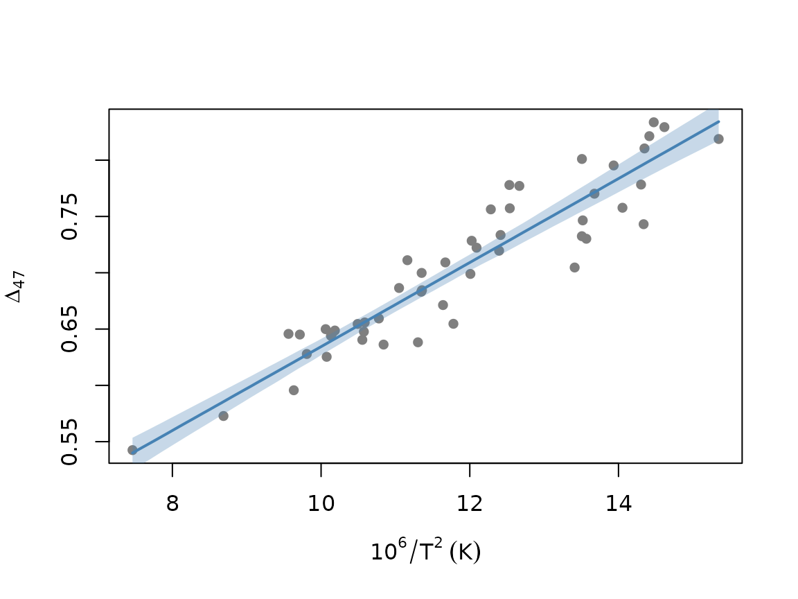

# 2. Frequentist calibrations and reconstructions

This vignette compares the four frequentist regression models in
`bayclumpr`. It also shows how to plot a calibration and reconstruct
temperatures. If you’re new to the package, start with
[`vignette("bayclumpr", package = "bayclumpr")`](https://tripati-lab.github.io/bayclumpr/articles/bayclumpr.md).

``` r

library(bayclumpr)
```

## The four models

The models differ in which measurement errors they account for.

| Function | Model | Errors in `Temperature` | Errors in `D47` |
|:---|:---|:--:|:--:|
| [`cal.ols()`](https://tripati-lab.github.io/bayclumpr/reference/cal.ols.md) | Ordinary least squares | No | No |
| [`cal.wols()`](https://tripati-lab.github.io/bayclumpr/reference/cal.wols.md) | Weighted least squares | No | No |
| [`cal.deming()`](https://tripati-lab.github.io/bayclumpr/reference/cal.deming.md) | Deming regression (`deming` package) | Yes | Yes |
| [`cal.york()`](https://tripati-lab.github.io/bayclumpr/reference/cal.york.md) | York regression (`IsoplotR` package) | Yes | Yes |

The weights in
[`cal.wols()`](https://tripati-lab.github.io/bayclumpr/reference/cal.wols.md)
don’t come from the reported errors. They come from a regression of the
absolute residuals on the fitted values, so observations in regions with
more scatter get less weight.
[`cal.deming()`](https://tripati-lab.github.io/bayclumpr/reference/cal.deming.md)
and
[`cal.york()`](https://tripati-lab.github.io/bayclumpr/reference/cal.york.md)
use `TempError` and `D47error` for each observation.

All four functions use bootstrapping. Each replicate resamples the
calibration dataset with replacement and fits the model again. The
result has one row per replicate, with the intercept (`alpha`), the
slope (`beta`), and the residual SD of D47 around the fitted line
(`sigma`). The default is 1,000 replicates. Replicates that fail are
removed with a warning.

## Fitting the models

We simulate 50 observations under the intermediate error scenario. The
true values are `alpha` = 0.268 and `beta` = 0.0369.

``` r

set.seed(3)
ds <- cal.dataset(error = "S2", nobs = 50)

fits <- list(
  OLS = cal.ols(data = ds),
  WOLS = cal.wols(data = ds),
  Deming = cal.deming(data = ds),
  York = cal.york(data = ds)
)
#> Warning in .bootstrap(data, replicates, samples, function(d) {: 32 of 1000
#> bootstrap replicates failed and were removed.
```

[`cal.summary()`](https://tripati-lab.github.io/bayclumpr/reference/cal.summary.md)
gives the estimate, standard error, and 95% interval of each parameter.
We combine the summaries of the four models into one table:

``` r

sums <- lapply(names(fits), function(m) cbind(model = m, cal.summary(fits[[m]])))
do.call(rbind, sums)
#>     model parameter   estimate          SE     median      lower      upper
#> 1     OLS     alpha 0.26938557 0.020490783 0.26939826 0.22882908 0.31002973
#> 2     OLS      beta 0.03662650 0.001835708 0.03667476 0.03298794 0.04025965
#> 3     OLS     sigma 0.02481634 0.002303671 0.02480963 0.01999532 0.02932177
#> 4    WOLS     alpha 0.26424805 0.018430253 0.26535566 0.22318837 0.30313896
#> 5    WOLS      beta 0.03705470 0.001693005 0.03694955 0.03368568 0.04075382
#> 6    WOLS     sigma 0.02497436 0.002315616 0.02507140 0.02032563 0.02921380
#> 7  Deming     alpha 0.26123043 0.021732629 0.26122114 0.21868252 0.30506100
#> 8  Deming      beta 0.03731127 0.001950126 0.03734394 0.03346909 0.04101653
#> 9  Deming     sigma 0.02474485 0.002331213 0.02479259 0.01972943 0.02906708
#> 10   York     alpha 0.26060948 0.020739581 0.26119824 0.21832058 0.30031487
#> 11   York      beta 0.03736634 0.001864008 0.03732117 0.03372884 0.04112536
#> 12   York     sigma 0.02483864 0.002223530 0.02481953 0.02053769 0.02914216
```

`SE` is the standard error of each estimate, which is the SD of the
bootstrap replicates. `sigma` is itself an SD: the scatter of individual
samples around the calibration line.

## Plotting a calibration

[`cal.ci()`](https://tripati-lab.github.io/bayclumpr/reference/cal.ci.md)
takes the table of `alpha` and `beta` and returns the median line and
its interval over a range of temperatures. Here we plot the York
calibration:

``` r

ci <- cal.ci(fits$York, from = min(ds$Temperature), to = max(ds$Temperature))

plot(D47 ~ Temperature, data = ds, pch = 16, col = "grey50",
     xlab = expression(10^6 / T^2 ~ (K)), ylab = expression(Delta[47]))
polygon(c(ci$x, rev(ci$x)), c(ci$ci_lower_est, rev(ci$ci_upper_est)),
        col = adjustcolor("steelblue", 0.3), border = NA)
lines(ci$x, ci$median_est, col = "steelblue", lwd = 2)
```



The `level` argument changes the probability covered by the interval.

## Reconstructing temperatures

[`rec.clumped()`](https://tripati-lab.github.io/bayclumpr/reference/rec.clumped.md)
reconstructs temperatures from any of these tables. We create a
reconstruction dataset with three D47 values, each measured with two
levels of precision. Each sample has three replicates (`N`):

``` r

recData <- data.frame(
  Sample = paste("Sample", 1:6),
  D47 = rep(c(0.6, 0.7, 0.8), 2),
  D47error = rep(c(0.005, 0.02), each = 3),
  N = 3
)

rec.clumped(recData = recData, obCal = fits$York)
#>     Sample D47 D47error  meanTemp        SD        SE    median      lower
#> 1 Sample 1 0.6    0.005 58.660721  4.911186  3.437023 58.689392  52.365029
#> 2 Sample 2 0.7    0.005 18.468403  3.144981  2.033767 18.499254  14.505023
#> 3 Sample 3 0.8    0.005 -9.948346  2.746298  2.140530 -9.970323 -14.304470
#> 4 Sample 4 0.6    0.020 58.660721 17.889727 10.230931 58.677627  40.359815
#> 5 Sample 5 0.7    0.020 18.468403 11.857550  6.714127 18.451745   6.318366
#> 6 Sample 6 0.8    0.020 -9.948346  8.795746  5.209176 -9.889112 -19.740435
#>       upper
#> 1 65.912565
#> 2 22.491652
#> 3 -6.006534
#> 4 80.930619
#> 5 32.399350
#> 6  0.506923
```

`meanTemp` is the temperature (°C) from the mean slope and intercept.
`SE` is the standard error of the temperature, based on `D47error`. `SD`
is the uncertainty of the temperature of a single replicate, based on
`D47error` × sqrt(`N`). `median`, `lower`, and `upper` describe the 95%
interval, based on `SE`.

By default, both `SD` and `SE` combine the error in `D47` with the
spread of slopes and intercepts in the bootstrap. It describes the
temperature predicted by the calibration line. With `prediction = TRUE`,
it also includes the scatter of individual samples around that line
(`sigma`). This is the same kind of uncertainty given by
[`rec.bayesian()`](https://tripati-lab.github.io/bayclumpr/reference/rec.bayesian.md):

``` r

rec.clumped(recData = recData, obCal = fits$York, prediction = TRUE)
#>     Sample D47 D47error  meanTemp        SD        SE    median       lower
#> 1 Sample 1 0.6    0.005 58.660721 13.355650 13.100220 58.522687  36.0218934
#> 2 Sample 2 0.7    0.005 18.468403  8.920905  8.609901 18.478843   2.8886739
#> 3 Sample 3 0.8    0.005 -9.948346  6.752931  6.606941 -9.938659 -22.4203021
#> 4 Sample 4 0.6    0.020 58.660721 22.292554 16.438161 58.736171  31.7338271
#> 5 Sample 5 0.7    0.020 18.468403 14.698848 10.791817 18.531687  -0.8737733
#> 6 Sample 6 0.8    0.020 -9.948346 10.827631  8.148936 -9.919308 -24.7868063
#>       upper
#> 1 87.801710
#> 2 36.923803
#> 3  3.486241
#> 4 95.620878
#> 5 42.036172
#> 6  7.191009
```

We can also reconstruct the same samples under every model:

``` r

recs <- lapply(fits, function(f) rec.clumped(recData = recData, obCal = f)$meanTemp)
cbind(recData, do.call(cbind, recs))
#>     Sample D47 D47error N       OLS      WOLS    Deming      York
#> 1 Sample 1 0.6    0.005 3  59.69100  59.05976 58.719871 58.660721
#> 2 Sample 2 0.7    0.005 3  18.49426  18.45971 18.459570 18.468403
#> 3 Sample 3 0.8    0.005 3 -10.42089 -10.15967 -9.990839 -9.948346
#> 4 Sample 4 0.6    0.020 3  59.69100  59.05976 58.719871 58.660721
#> 5 Sample 5 0.7    0.020 3  18.49426  18.45971 18.459570 18.468403
#> 6 Sample 6 0.8    0.020 3 -10.42089 -10.15967 -9.990839 -9.948346
```
