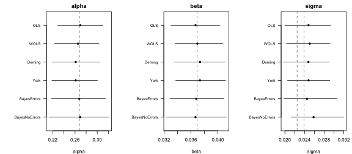
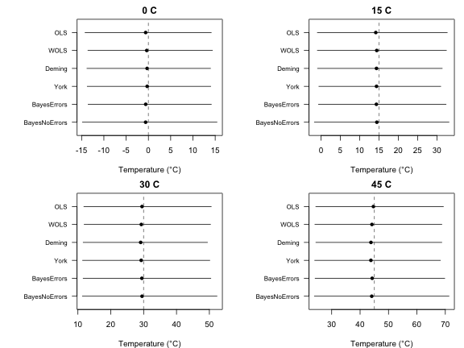
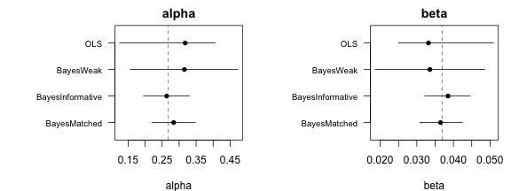
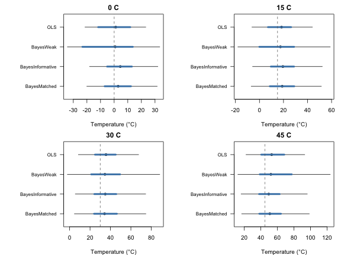
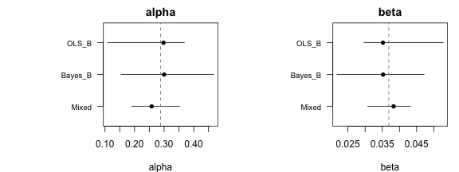
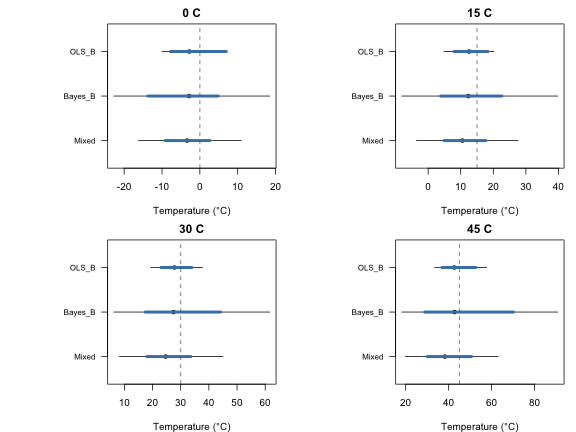

This vignette fits frequentist and Bayesian calibrations to the same dataset and compares their parameters and reconstructions. It then shows two cases where the Bayesian approach narrows uncertainty: small datasets with informative priors, and mixed models where one material has few observations. We use simulated datasets, so we know the true values. It builds on `vignette("frequentist", package = "bayclumpr")` and `vignette("bayesian", package = "bayclumpr")`.


``` r
library(bayclumpr)
```

## The dataset

We simulate 50 observations under the intermediate error scenario. The true intercept is 0.268 and the true slope is 0.0369.


``` r
set.seed(3)
ds <- cal.dataset(error = "S2", nobs = 50)
```

Two true values of `sigma` are useful here. The scatter of individual samples around the line, without measurement error, is 0.0225. Adding the measurement errors in `D47` and `Temperature` raises it to about 0.0239.

## Fitting the calibrations

We fit the four frequentist models and two Bayesian models: one that uses measurement errors and one that ignores them. We use weak priors, so the Bayesian results depend on the data and not on prior information. This makes the comparison with the frequentist models fair.


``` r
freq <- list(
  OLS = cal.ols(data = ds),
  WOLS = cal.wols(data = ds),
  Deming = cal.deming(data = ds),
  York = cal.york(data = ds)
)
#> Warning in .bootstrap(data, replicates, samples, function(d) {: 32 of 1000 bootstrap
#> replicates failed and were removed.

bayes <- cal.bayesian(calibrationData = ds, models = c("errors", "noerrors"), priors = "Weak")
```

`cal.draws()` puts the Bayesian draws in the same shape as the bootstrap replicates, so we can store all six calibrations in one list:


``` r
fits <- c(freq, list(
  BayesErrors = cal.draws(bayes, model = "errors"),
  BayesNoErrors = cal.draws(bayes, model = "noerrors")
))
```

## Comparing parameters

`cal.summary()` summarizes every calibration in the same way. We combine the six summaries into one table:


``` r
pars <- do.call(rbind, lapply(names(fits), function(m) cbind(method = m, cal.summary(fits[[m]]))))
pars
#>           method parameter   estimate          SE     median      lower      upper ESS Rhat
#> 1            OLS     alpha 0.26938557 0.020490783 0.26939826 0.22882908 0.31002973  NA   NA
#> 2            OLS      beta 0.03662650 0.001835708 0.03667476 0.03298794 0.04025965  NA   NA
#> 3            OLS     sigma 0.02481634 0.002303671 0.02480963 0.01999532 0.02932177  NA   NA
#> 4           WOLS     alpha 0.26424805 0.018430253 0.26535566 0.22318837 0.30313896  NA   NA
#> 5           WOLS      beta 0.03705470 0.001693005 0.03694955 0.03368568 0.04075382  NA   NA
#> 6           WOLS     sigma 0.02497436 0.002315616 0.02507140 0.02032563 0.02921380  NA   NA
#> 7         Deming     alpha 0.26123043 0.021732629 0.26122114 0.21868252 0.30506100  NA   NA
#> 8         Deming      beta 0.03731127 0.001950126 0.03734394 0.03346909 0.04101653  NA   NA
#> 9         Deming     sigma 0.02474485 0.002331213 0.02479259 0.01972943 0.02906708  NA   NA
#> 10          York     alpha 0.26060948 0.020739581 0.26119824 0.21832058 0.30031487  NA   NA
#> 11          York      beta 0.03736634 0.001864008 0.03732117 0.03372884 0.04112536  NA   NA
#> 12          York     sigma 0.02483864 0.002223530 0.02481953 0.02053769 0.02914216  NA   NA
#> 13   BayesErrors     alpha 0.26730177 0.024543403 0.26759312 0.21768550 0.31483752  NA   NA
#> 14   BayesErrors      beta 0.03679598 0.002041054 0.03678283 0.03286877 0.04090155  NA   NA
#> 15   BayesErrors     sigma 0.02463271 0.002759222 0.02451672 0.01981052 0.03052497  NA   NA
#> 16 BayesNoErrors     alpha 0.26859589 0.026828592 0.26913052 0.21286998 0.32134552  NA   NA
#> 17 BayesNoErrors      beta 0.03668889 0.002237532 0.03666659 0.03231665 0.04126362  NA   NA
#> 18 BayesNoErrors     sigma 0.02607393 0.002772372 0.02584695 0.02128824 0.03199959  NA   NA
```

To plot them, we use a small function that draws the median and the 95% interval of each method:


``` r
# Median and interval of each method, with the true value as a dashed line
plotRanges <- function(est, lower, upper, labels, truth, xlab, main) {
  y <- rev(seq_along(est))
  plot(est, y, xlim = range(lower, upper, truth), ylim = c(0.5, length(est) + 0.5),
       yaxt = "n", pch = 16, xlab = xlab, ylab = "", main = main)
  segments(lower, y, upper, y)
  axis(2, at = y, labels = labels, las = 1, cex.axis = 0.8)
  abline(v = truth, lty = 2, col = "grey40")
}
```


``` r
op <- par(mfrow = c(1, 3), mar = c(4, 8, 2, 1))
for (p in c("alpha", "beta", "sigma")) {
  d <- pars[pars$parameter == p, ]
  truth <- switch(p, alpha = 0.268, beta = 0.0369, sigma = c(0.0225, 0.0239))
  plotRanges(d$median, d$lower, d$upper, d$method, truth, xlab = p, main = p)
}
```



``` r
par(op)
```

A few things to look for in these plots:

- In this scenario, the errors in `Temperature` are small relative to the spread of temperatures. Ignoring them shrinks the OLS slope by only about 0.15%, so all methods should recover similar slopes.
- Bootstrap intervals and posterior intervals answer different questions, but with 50 observations and weak priors, they tend to have similar widths.
- `sigma` differs by design. The Bayesian errors model removes the measurement errors, so its `sigma` estimates 0.0225. The other methods report the residual SD around the fitted line, so their `sigma` estimates 0.0239. With 50 observations, each estimate has a standard error of about 0.002, so they won't match these values exactly.

## Comparing reconstructions

We create four samples with known temperatures: 0, 15, 30, and 45 °C. Their D47 values fall exactly on the true calibration line. Each sample is the mean of four replicates with a standard error of 0.005.


``` r
trueTemp <- c(0, 15, 30, 45)

recData <- data.frame(
  Sample = paste(trueTemp, "C"),
  D47 = 0.268 + 0.0369 * temp2x(trueTemp)$Temperature,
  D47error = 0.005,
  N = 4
)
```

The Bayesian reconstructions include the scatter of individual samples around the calibration line (`sigma`). For a fair comparison, we use `prediction = TRUE` in `rec.clumped()`, so the frequentist reconstructions include it too.


``` r
recs <- do.call(rbind, lapply(names(fits), function(m) {
  r <- if (m %in% names(freq)) {
    rec.clumped(recData = recData, obCal = fits[[m]], prediction = TRUE)
  } else {
    rec.bayesian(calModel = fits[[m]], recData = recData)
  }
  cbind(method = m, r)
}))

recs[, c("method", "Sample", "meanTemp", "SD", "SE", "median", "lower", "upper")]
#>           method Sample   meanTemp        SD        SE     median       lower    upper
#> 1            OLS    0 C -0.6321531  7.594940  7.198448 -0.6164261 -14.2222408 14.11506
#> 2            OLS   15 C 14.3787144  8.892067  8.478055 14.1737325  -0.9486301 32.67945
#> 3            OLS   30 C 29.3969152 10.478036  9.826486 29.5111685  11.8196976 50.56258
#> 4            OLS   45 C 44.4228376 11.987783 11.447905 44.6936237  24.4225767 69.32036
#> 5           WOLS    0 C -0.4604235  7.740718  7.213856 -0.3672330 -13.5773180 14.37793
#> 6           WOLS   15 C 14.3921647  8.834916  8.441088 14.4244825  -0.9438786 32.45630
#> 7           WOLS   30 C 29.2253475 10.373349  9.760972 29.2962292  11.9032007 50.33997
#> 8           WOLS   45 C 44.0381604 11.922576 11.290023 44.1702639  24.0975766 68.77121
#> 9         Deming    0 C -0.3427476  7.520083  7.076323 -0.2850700 -13.8003683 13.95006
#> 10        Deming   15 C 14.4194203  8.653930  8.233398 14.3602174  -0.9035868 31.37766
#> 11        Deming   30 C 29.1470397 10.165391  9.571542 29.0985619  11.6087616 49.41607
#> 12        Deming   45 C 43.8384573 11.936121 11.280141 43.8283002  24.4476186 68.76120
#> 13          York    0 C -0.3104239  7.435042  7.075957 -0.2732568 -13.7313391 13.99143
#> 14          York   15 C 14.4337222  8.918905  8.195478 14.3672827  -0.5585507 30.99715
#> 15          York   30 C 29.1402527 10.162500  9.730341 29.2598505  11.4267711 50.12229
#> 16          York   45 C 43.8073818 11.805321 11.156122 43.8101279  24.0242764 68.26650
#> 17   BayesErrors    0 C -0.3682649  7.475467  7.046920 -0.6063122 -13.5343079 14.13353
#> 18   BayesErrors   15 C 14.7187942  8.868534  8.380187 14.3322017  -0.6561463 32.36621
#> 19   BayesErrors   30 C 29.8792079 10.284892  9.804652 29.4628342  11.6000191 50.43740
#> 20   BayesErrors   45 C 44.9283832 12.062642 11.516244 44.2557390  24.1800483 69.79286
#> 21 BayesNoErrors    0 C -0.3397851  8.045796  7.671513 -0.6224513 -14.8200158 15.40411
#> 22 BayesNoErrors   15 C 14.7836824  9.364840  8.865810 14.4512593  -1.7186166 33.12994
#> 23 BayesNoErrors   30 C 30.0231868 10.851156 10.359854 29.5155106  11.3702679 52.31710
#> 24 BayesNoErrors   45 C 45.0401321 12.950560 12.120504 44.1019026  23.9225760 71.29317
```

We plot the median and the 95% interval of each sample under each method. The dashed lines show the true temperatures.


``` r
op <- par(mfrow = c(2, 2), mar = c(4, 8, 2, 1))
for (i in seq_along(trueTemp)) {
  d <- recs[recs$Sample == recData$Sample[i], ]
  plotRanges(d$median, d$lower, d$upper, d$method, trueTemp[i], xlab = "Temperature (°C)", main = recData$Sample[i])
}
```



``` r
par(op)
```

A few things to look for in these plots:

- The intervals widen at higher temperatures. D47 changes less per degree when it's warm, so the same error in D47 spans more degrees.
- The intervals are not symmetric around the median, for the same reason.
- In this dataset, most of the width comes from `sigma`, the scatter of individual samples around the calibration line. It is about five times larger than `D47error`. Without it (`prediction = FALSE`), the frequentist intervals only describe the temperature predicted by the line, and they are much narrower.

## Without the residual scatter

To see how much `sigma` contributes, we compare the standard errors of the OLS reconstructions with and without it:


``` r
data.frame(
  Sample = recData$Sample,
  SE_line = rec.clumped(recData = recData, obCal = fits$OLS)$SE,
  SE_prediction = rec.clumped(recData = recData, obCal = fits$OLS, prediction = TRUE)$SE
)
#>   Sample  SE_line SE_prediction
#> 1    0 C 2.037145      7.143138
#> 2   15 C 2.021889      8.425822
#> 3   30 C 2.243128      9.774638
#> 4   45 C 2.783529     11.669806
```

Use `prediction = FALSE` when the question is about the temperature predicted by the calibration line. Use `prediction = TRUE`, or `rec.bayesian()`, when the question is about the temperature of an individual sample.

## When the Bayesian approach narrows uncertainty

The frequentist and Bayesian results above are very similar. This is expected. Both fit the same model to the same 50 observations, and the weak priors add almost no information. A Bayesian model narrows uncertainty only when it uses information that the frequentist fit doesn't have. The next two cases show this.

### Small datasets with informative priors

The precision of a prior adds to the precision of the data. With 50 observations, the slope has an SE of about 0.0017 from the data alone. A prior SD of 0.004 narrows it by only about 8%. With 10 observations, the SE from the data alone is about 0.004, the same as the prior SD. The prior should then narrow the slope's interval by about 30%.

We simulate 10 observations and fit OLS and three Bayesian versions of the errors model:

- `BayesWeak` uses weak priors.
- `BayesInformative` uses the informative preset. Its means (0.231 and 0.039) are not the true values of this simulation (0.268 and 0.0369).
- `BayesMatched` uses the same SDs as the informative preset, centered on the true values. This is what a prior from an earlier calibration in the same reference frame would look like.


``` r
small <- cal.dataset(error = "S2", nobs = 10)
matched <- list(alpha = c(0.268, 0.065), beta = c(0.0369, 0.004))

smallFits <- list(
  OLS = cal.ols(data = small),
  BayesWeak = cal.draws(cal.bayesian(calibrationData = small, models = "errors", priors = "Weak")),
  BayesInformative = cal.draws(cal.bayesian(calibrationData = small, models = "errors", priors = "Informative")),
  BayesMatched = cal.draws(cal.bayesian(calibrationData = small, models = "errors", priors = matched))
)

smallPars <- do.call(rbind, lapply(names(smallFits), function(m) cbind(method = m, cal.summary(smallFits[[m]]))))
smallPars
#>              method parameter   estimate          SE     median      lower      upper ESS
#> 1               OLS     alpha 0.30750311 0.070589913 0.31772707 0.12542545 0.40574002  NA
#> 2               OLS      beta 0.03434248 0.006538214 0.03318122 0.02497593 0.05095105  NA
#> 3               OLS     sigma 0.03045302 0.007089762 0.03151556 0.01276731 0.04084255  NA
#> 4         BayesWeak     alpha 0.31531704 0.079516741 0.31549133 0.15718241 0.47302565  NA
#> 5         BayesWeak      beta 0.03356455 0.007521755 0.03356495 0.01861357 0.04858040  NA
#> 6         BayesWeak     sigma 0.04049678 0.013035279 0.03788493 0.02349542 0.07553981  NA
#> 7  BayesInformative     alpha 0.26320642 0.033901102 0.26355254 0.19502135 0.33032058  NA
#> 8  BayesInformative      beta 0.03848014 0.003102341 0.03852054 0.03219750 0.04455822  NA
#> 9  BayesInformative     sigma 0.03939186 0.011818486 0.03722380 0.02318438 0.06872334  NA
#> 10     BayesMatched     alpha 0.28401429 0.032761749 0.28402868 0.22036974 0.34778233  NA
#> 11     BayesMatched      beta 0.03650246 0.003002458 0.03647967 0.03082584 0.04238859  NA
#> 12     BayesMatched     sigma 0.03843304 0.011774738 0.03630002 0.02298066 0.06737819  NA
#>    Rhat
#> 1    NA
#> 2    NA
#> 3    NA
#> 4    NA
#> 5    NA
#> 6    NA
#> 7    NA
#> 8    NA
#> 9    NA
#> 10   NA
#> 11   NA
#> 12   NA
```


``` r
op <- par(mfrow = c(1, 2), mar = c(4, 9, 2, 1))
for (p in c("alpha", "beta")) {
  d <- smallPars[smallPars$parameter == p, ]
  plotRanges(d$median, d$lower, d$upper, d$method, switch(p, alpha = 0.268, beta = 0.0369), xlab = p, main = p)
}
```



``` r
par(op)
```

Both informative priors should give narrower intervals than OLS and the weak priors. The matched prior narrows them around the true values. The informative preset can also pull the estimates toward its own means. A prior that doesn't suit the data gives narrower intervals around the wrong values.

How much does this help reconstructions? `rec.clumped()` works with any table of draws, Bayesian ones included. We use it to reconstruct the four samples from earlier in two ways: for the calibration line alone (`prediction = FALSE`) and for individual samples (`prediction = TRUE`).


``` r
smallLine <- lapply(smallFits, function(f) rec.clumped(recData = recData, obCal = f))
#> Warning in .rec_exact(obCal, recData, ndraws, level = level): 14 draws had 10^6/T^2 at or
#> below zero and were removed.
smallSample <- lapply(smallFits, function(f) rec.clumped(recData = recData, obCal = f, prediction = TRUE))
#> Warning in .rec_exact(obCal, recData, ndraws, level = level): 51 draws had 10^6/T^2 at or
#> below zero and were removed.
```

To plot both, we use a second function. For each method, the thick blue segment is the 95% interval for the calibration line and the thin black segment is the 95% interval for an individual sample.


``` r
# Intervals for the calibration line (thick) and for individual samples (thin)
plotRecs <- function(line, sample, labels, truth, main) {
  y <- rev(seq_along(labels))
  plot(sample$median, y, xlim = range(sample$lower, sample$upper, truth), ylim = c(0.5, length(y) + 0.5),
       yaxt = "n", pch = 16, xlab = "Temperature (°C)", ylab = "", main = main)
  segments(sample$lower, y, sample$upper, y)
  segments(line$lower, y, line$upper, y, lwd = 4, col = "steelblue")
  axis(2, at = y, labels = labels, las = 1, cex.axis = 0.8)
  abline(v = truth, lty = 2, col = "grey40")
}
```


``` r
op <- par(mfrow = c(2, 2), mar = c(4, 9, 2, 1))
for (i in seq_along(trueTemp)) {
  line <- do.call(rbind, lapply(smallLine, function(r) r[i, ]))
  sample <- do.call(rbind, lapply(smallSample, function(r) r[i, ]))
  plotRecs(line, sample, names(smallFits), trueTemp[i], main = recData$Sample[i])
}
```



``` r
par(op)
```

The same comparison as SEs:


``` r
lineSE <- sapply(smallLine, function(r) r$SE)
sampleSE <- sapply(smallSample, function(r) r$SE)
rownames(lineSE) <- rownames(sampleSE) <- recData$Sample

round(lineSE, 2)
#>       OLS BayesWeak BayesInformative BayesMatched
#> 0 C  5.87     16.29             4.65         4.83
#> 15 C 4.96     31.25             4.82         5.03
#> 30 C 5.19     16.60             5.40         5.65
#> 45 C 7.19     12.35             6.26         6.58
round(sampleSE, 2)
#>        OLS BayesWeak BayesInformative BayesMatched
#> 0 C  11.27     17.92            12.84        13.14
#> 15 C 12.52     20.84            14.57        14.78
#> 30 C 14.88     28.22            17.45        17.61
#> 45 C 18.33     54.44            20.10        21.50
```

The informative priors should narrow the thick segments, which describe the calibration line. The thin segments change much less. For individual samples, `sigma` still makes up most of the uncertainty, and priors on `alpha` and `beta` can't reduce it.

### Unbalanced materials in mixed models

Mixed models help when one material has few observations. Its intercept and slope borrow strength from the other materials, and `sigma` is estimated from all observations.

We simulate three materials with the same slope. Materials A and C have 40 observations each. Material B has only 5, and its D47 values are 0.02 higher, so its true intercept is 0.288.


``` r
dsA <- cal.dataset(error = "S2", nobs = 40)
dsA$Material <- "A"
dsB <- cal.dataset(error = "S2", nobs = 5)
dsB$Material <- "B"
dsB$D47 <- dsB$D47 + 0.02
dsC <- cal.dataset(error = "S2", nobs = 40)
dsC$Material <- "C"
dsC$D47 <- dsC$D47 - 0.01
dsAll <- rbind(dsA, dsB, dsC)
```

We compare three ways to calibrate material B: OLS on B alone, a Bayesian model on B alone, and a mixed model with all three materials. Bootstrapping five observations is fragile, so a few replicates may fail.


``` r
mixedDraws <- cal.draws(cal.bayesian(calibrationData = dsAll, models = "mixed_noerrors", priors = "Weak"))
#> Warning: There were 31 divergent transitions after warmup. See
#> https://mc-stan.org/misc/warnings.html#divergent-transitions-after-warmup
#> to find out why this is a problem and how to eliminate them.
#> Warning: Examine the pairs() plot to diagnose sampling problems
#> Warning in .finish_fit(fits, prior, chains): Check convergence for: BLM3_fit. Print the
#> result for details.

matFits <- list(
  OLS_B = cal.ols(data = dsB),
  Bayes_B = cal.draws(cal.bayesian(calibrationData = dsB, models = "noerrors", priors = "Weak")),
  Mixed = mixedDraws[mixedDraws$Material == "B", ]
)
#> Warning in .bootstrap(data, replicates, samples, function(d) {: 2 of 1000 bootstrap
#> replicates failed and were removed.

cols <- c("parameter", "estimate", "SE", "median", "lower", "upper")
matPars <- do.call(rbind, lapply(names(matFits), function(m) cbind(method = m, cal.summary(matFits[[m]])[, cols])))
matPars
#>    method parameter    estimate          SE      median        lower      upper
#> 1   OLS_B     alpha 0.293031889 0.061163378 0.297859500 1.086626e-01 0.36834466
#> 2   OLS_B      beta 0.035893847 0.005291686 0.035198148 2.966941e-02 0.05276960
#> 3   OLS_B     sigma 0.007504592 0.004439064 0.008717914 6.345469e-17 0.01306020
#> 4 Bayes_B     alpha 0.301918753 0.098056914 0.300042359 1.546690e-01 0.46776434
#> 5 Bayes_B      beta 0.035101277 0.007487228 0.035238383 2.181148e-02 0.04717958
#> 6 Bayes_B     sigma 0.024380117 0.026673640 0.017451049 7.661979e-03 0.08193833
#> 7   Mixed     alpha 0.261820821 0.039324055 0.257858905 1.903353e-01 0.35243205
#> 8   Mixed      beta 0.037899047 0.003060337 0.038295001 3.071558e-02 0.04326353
#> 9   Mixed     sigma 0.023294291 0.001894409 0.023146456 1.998883e-02 0.02733562
```


``` r
op <- par(mfrow = c(1, 2), mar = c(4, 9, 2, 1))
for (p in c("alpha", "beta")) {
  d <- matPars[matPars$parameter == p, ]
  plotRanges(d$median, d$lower, d$upper, d$method, switch(p, alpha = 0.288, beta = 0.0369), xlab = p, main = p)
}
```



``` r
par(op)
```

The mixed model should give much narrower intervals for material B, since its slope is pulled toward the slopes of A and C.

Next, we reconstruct four samples of material B with the same true temperatures as before. Their D47 values are 0.02 higher, as in the calibration.


``` r
recB <- recData
recB$D47 <- recB$D47 + 0.02
recB$Material <- "B"

matLine <- lapply(matFits, function(f) rec.clumped(recData = recB, obCal = f))
#> Warning in .rec_exact(obCal, recData, ndraws, level = level): 42 draws had 10^6/T^2 at or
#> below zero and were removed.
matSample <- lapply(matFits, function(f) rec.clumped(recData = recB, obCal = f, prediction = TRUE))
#> Warning in .rec_exact(obCal, recData, ndraws, level = level): 99 draws had 10^6/T^2 at or
#> below zero and were removed.
```


``` r
op <- par(mfrow = c(2, 2), mar = c(4, 9, 2, 1))
for (i in seq_along(trueTemp)) {
  line <- do.call(rbind, lapply(matLine, function(r) r[i, ]))
  sample <- do.call(rbind, lapply(matSample, function(r) r[i, ]))
  plotRecs(line, sample, names(matFits), trueTemp[i], main = recB$Sample[i])
}
```



``` r
par(op)
```

The same comparison as SEs:


``` r
matLineSE <- sapply(matLine, function(r) r$SE)
matSampleSE <- sapply(matSample, function(r) r$SE)
rownames(matLineSE) <- rownames(matSampleSE) <- recB$Sample

round(matLineSE, 2)
#>      OLS_B Bayes_B Mixed
#> 0 C   3.30   10.57  2.99
#> 15 C  2.69  158.17  3.27
#> 30 C  2.94   37.27  4.02
#> 45 C  4.43   24.55  5.26
round(matSampleSE, 2)
#>      OLS_B Bayes_B Mixed
#> 0 C   4.18   18.03  6.93
#> 15 C  4.02   35.26  7.92
#> 30 C  4.62   45.79  9.34
#> 45 C  6.11   39.20 11.01
```

Here, both segments should narrow under the mixed model. The thick segments narrow because the slope of material B borrows strength from A and C. The thin segments narrow too, because `sigma` is now estimated from 85 observations instead of 5. With only five observations, `sigma` is poorly known, and the Bayesian model on B alone carries that uncertainty into its reconstructions.

Partial pooling assumes that materials are similar. Here, all three share the same slope, so pooling helps. If material B truly had a different slope, the mixed model would pull it toward the others. Also, with only three materials, the SDs among materials mostly reflect their priors.

## A note on single datasets

This vignette compares methods on one simulated dataset. A single dataset can't show which method is better on average, since every method will miss the true values by chance in some datasets. To evaluate methods, repeat the same steps on many simulated datasets and count how often each 95% interval contains the true value.
